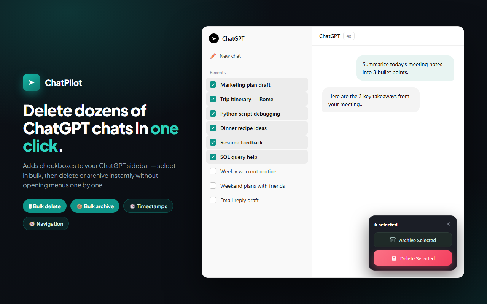
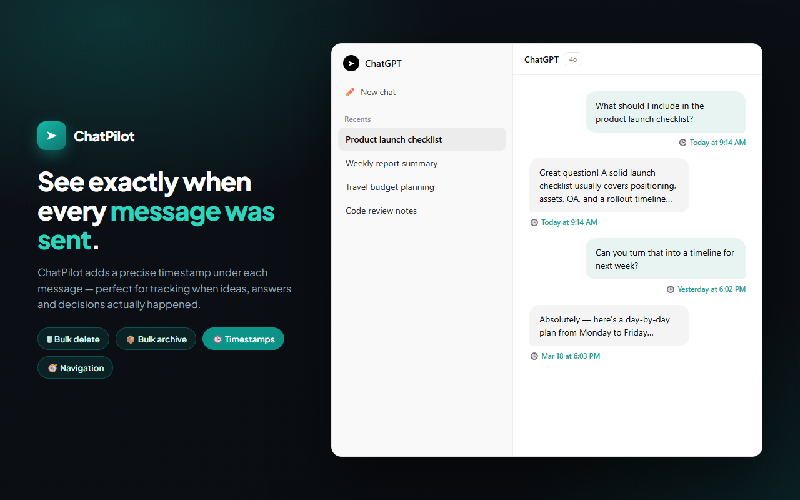

# ChatPilot: Bulk Delete and Archive ChatGPT Chats, with Message Timestamps

ChatPilot is a free Chrome extension for cleaning up a crowded ChatGPT sidebar. It adds checkboxes next to your conversations so you can select many at once and delete or archive them together. It also shows when each message was sent and adds a navigator for jumping through long conversations.

**[Install from the Chrome Web Store](https://chromewebstore.google.com/detail/gljaeinkkpdmfhndfedonbihkdmebjlj?utm_source=github&utm_medium=readme&utm_campaign=chatpilot)** | **[Full guide and FAQ](https://www.addonschrome.com/extensions/chatpilot-chatgpt-bulk-delete-archive-timestamps.html?utm_source=github&utm_medium=readme&utm_campaign=chatpilot)**

This repository is the public home for ChatPilot documentation, release notes and the issue tracker. The extension itself is distributed through the Chrome Web Store.

## Features

- **Bulk delete:** tick the chats you no longer need and remove them in one go
- **Bulk archive:** move chats out of the sidebar without deleting them
- **Shift-click range select:** click the first chat, hold Shift, click the last one
- **Message timestamps:** see exactly when each message was sent
- **Conversation navigator:** jump between messages in a long chat
- Interface available in 60+ languages

## Archive or delete?

Archiving hides a chat from the sidebar and you can bring it back later. Deleting removes it from your ChatGPT account. If you are not sure, archive first.

## How to use it

1. Install ChatPilot from the [Chrome Web Store](https://chromewebstore.google.com/detail/gljaeinkkpdmfhndfedonbihkdmebjlj?utm_source=github&utm_medium=readme&utm_campaign=chatpilot).
2. Open ChatGPT. Checkboxes appear next to the chats in the sidebar.
3. Select the chats (use Shift-click for a range).
4. Choose Archive selected or Delete selected and confirm.

The [full guide](https://www.addonschrome.com/extensions/chatpilot-chatgpt-bulk-delete-archive-timestamps.html?utm_source=github&utm_medium=readme&utm_campaign=chatpilot) shows each feature with screenshots.

## Pricing and privacy

ChatPilot is free. It works in your own ChatGPT session in the browser.

## Screenshots

## Support and feedback

Found a bug or want a feature? [Open an issue](../../issues) in this repository. Please include your Chrome version and the steps that led to the problem.

## Disclaimer

ChatPilot is an independent tool and is not affiliated with, endorsed by or sponsored by OpenAI. ChatGPT is a trademark of OpenAI. Deleted chats cannot be restored by the extension, so check your selection before you confirm.

---

Built and maintained by [Addons Chrome](https://www.addonschrome.com/?utm_source=github&utm_medium=readme&utm_campaign=chatpilot).
